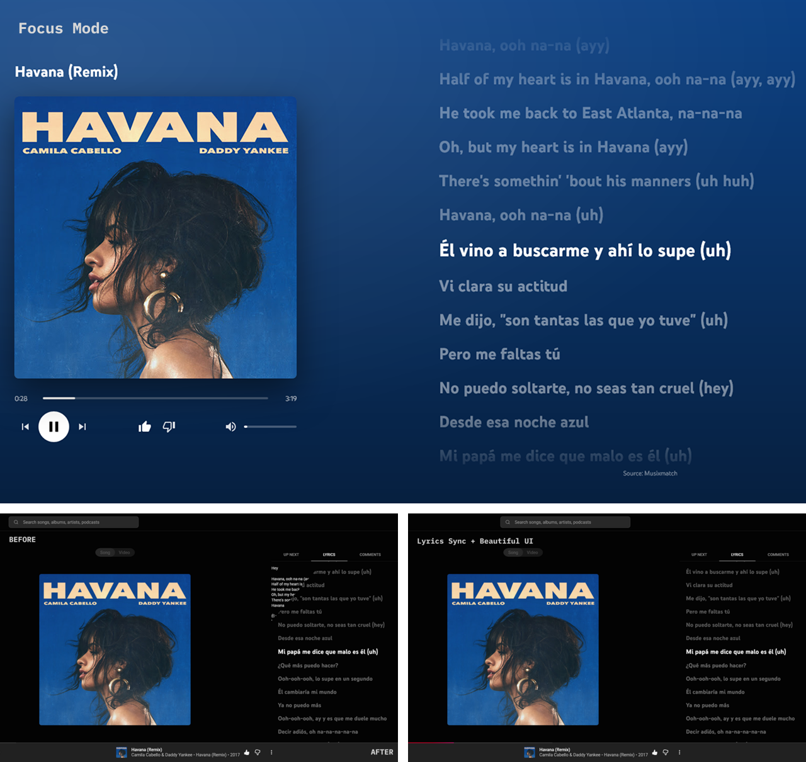

<p align="center">
  
</p>

<h1 align="center">Verso</h1>

<p align="center">
  <strong>Karaoke-style, time-synced lyrics and a distraction-free focus mode for YouTube Music.</strong>
</p>

<p align="center">
  <a href="https://chromewebstore.google.com/detail/verso-%E2%80%93-youtube-music-lyr/hacckbeagegildemobkfelpfcidipagf" target="_blank">
    
  </a>
  <a href="https://addons.mozilla.org/en-US/firefox/addon/verso-youtube-music-lyrics/" target="_blank">
    
  </a>
</p>

<p align="center">
  
  
  
  
  
  <a href="LICENSE" target="_blank">
    
  </a>
</p>

<p align="center">
  
</p>

## ✨ Features

- 🎤 **Synced lyrics** – the current line is highlighted in real time as the song plays.
- 📜 **Auto-scroll** – the lyrics list follows the music so you never lose your place.
- ⏩ **Click to seek** – click any line to jump straight to that part of the song.
- 🎧 **Focus mode** – a full-screen view with just the cover (or video), the playback controls and the lyrics, over a background taken from the artwork. Open it from the button in the player bar; close it with ✕ or `Esc`.
- 🔒 **Private by design** – no permissions, no tracking, no data collection.

## 📦 Install

Install Verso from the [Chrome Web Store](https://chromewebstore.google.com/detail/verso-%E2%80%93-youtube-music-lyr/hacckbeagegildemobkfelpfcidipagf) or [Firefox Add-ons](https://addons.mozilla.org/en-US/firefox/addon/verso-youtube-music-lyrics/), then open [YouTube Music](https://music.youtube.com), play a song and open the **Lyrics** tab.

## 🛠️ Development

### Prerequisites

- node 26.4.0 (`nvm use`)
- pnpm 10.34.5 (`corepack enable`)
- Chrome/Edge >=120 or Firefox >=140

### Setup

```sh
pnpm install --frozen-lockfile
pnpm build
```

Then load the extension in developer mode:

- **Chrome:** open `chrome://extensions`, enable **Developer mode**, click **Load unpacked** and select `dist/chrome`.
- **Edge:** open `edge://extensions`, enable **Developer mode**, click **Load unpacked** and select `dist/edge`.
- **Firefox:** open `about:debugging#/runtime/this-firefox`, click **Load Temporary Add-on…** and select `dist/firefox/manifest.json`.

### Packaging

To build the store zips into `dist/artifacts/`:

```sh
pnpm package
```

### Tests

```sh
pnpm test
```

## 🔒 Privacy

Verso requests no permissions, collects no data and only talks to YouTube Music itself.

> Not affiliated with, endorsed by or sponsored by YouTube or Google.

## 👤 Author

**Gabriel Sena** – [@gabrielsenadev](https://github.com/gabrielsenadev)

## 🤝 Contributing

Contributions, issues and feature requests are welcome!<br />
Feel free to check the [issues page](https://github.com/gabrielsenadev/verso/issues).

## 💛 Show your support

Give a ⭐️ if this project helped you!

<a href="https://buymeacoffee.com/gabrielsenadev" target="_blank">
  
</a>

## 📝 License

Copyright © 2026 [Gabriel Sena](https://github.com/gabrielsenadev).<br />
This project is [MIT](LICENSE) licensed.
