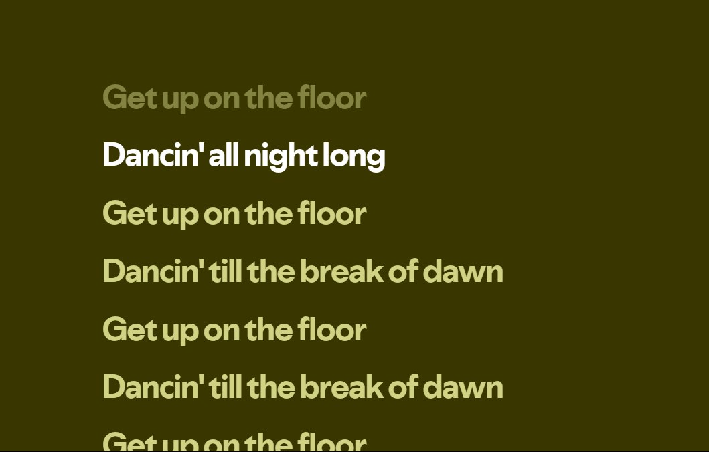

# Synced Lyrics for YouTube Music

> Not affiliated with, endorsed by or sponsored by YouTube or Google.

Browser extension that replaces the YouTube Music lyrics tab with time-synced,
karaoke-style lyrics: the current line is highlighted as the song plays, the
list auto-scrolls, and clicking a line (or focusing it and pressing
Enter/Space) seeks the player to that timestamp.

Works on Chrome/Chromium/Edge (MV3, 120+) and Firefox 140+, in any YouTube
Music interface language.



## Requirements

Versions are pinned so builds are reproducible (AMO reviewers rebuild the
submitted source and compare the output):

- [Node.js](https://nodejs.org) **26.4.0** — pinned in `.nvmrc`; run `nvm use`.
  The build script itself is TypeScript, run through Node's built-in type
  stripping.
- [pnpm](https://pnpm.io) **10.34.5** — pinned in `package.json`'s
  `packageManager` field; `corepack enable` picks it up automatically.
- Chrome/Chromium/Edge **120+**, and/or Firefox **140+**

`engine-strict` is on, so installing with any other Node or pnpm version fails
instead of silently producing a different build. Every dependency is pinned to
an exact version, and `pnpm-lock.yaml` is committed.

The extension is written in TypeScript and bundled to plain JS with esbuild; the
shipped extension has no runtime dependencies.

## Build

```bash
nvm use
corepack enable
pnpm install --frozen-lockfile
pnpm build           # production build of both targets
pnpm build:dev       # development build (logging + inline source maps)
```

This produces two unpacked extension directories:

```
dist/chrome/     # load this in Chrome
dist/firefox/    # load this in Firefox
```

Build a single target if you prefer:

```bash
pnpm build:chrome
pnpm build:firefox
```

Other commands:

| Command | What it does |
| --- | --- |
| `pnpm test` | Type-checks the project, then runs the build tests (`node --test`) |
| `pnpm typecheck` | Type-checks without emitting anything (`tsc --noEmit`) |
| `pnpm lint:firefox` | Validates the Firefox build with `web-ext lint` |
| `pnpm dev:firefox` | Builds, then launches a temporary Firefox profile with the extension loaded |
| `pnpm package` | Builds both targets and zips them into `dist/artifacts/` for store upload |
| `pnpm clean` | Deletes `dist/` |

## Install in developer mode

### Chrome / Chromium / Edge

1. `pnpm build:chrome`
2. Open `chrome://extensions` (Edge: `edge://extensions`).
3. Turn on **Developer mode** (top-right toggle).
4. Click **Load unpacked** and select the `dist/chrome` directory.
5. Open <https://music.youtube.com>, play a song, and open the **Lyrics** tab.

After changing code, run `pnpm build:chrome` again and hit the **reload** icon
on the extension card. Reload the YouTube Music tab too — content scripts are
injected at page load.

### Firefox

The quickest path is `pnpm dev:firefox`, which builds the extension, opens a
throwaway Firefox profile with it already installed, and live-reloads on every
rebuild.

To install it into your normal profile instead:

1. `pnpm build:firefox`
2. Open `about:debugging#/runtime/this-firefox`.
3. Click **Load Temporary Add-on…**.
4. Select `dist/firefox/manifest.json` (the manifest file itself, not the folder).
5. Open <https://music.youtube.com>, play a song, and open the **Lyrics** tab.

After changing code, run `pnpm build:firefox` again and click **Reload** on the
extension in `about:debugging`. Temporary add-ons are removed when Firefox
closes, so this has to be repeated each session.

## How it works

The extension is a single content script; there is no background script,
popup or options page.

- **Finding the lyrics.** The player page's tabs are rendered from YouTube
  Music's own data. The script reads that data and picks the tab whose page
  type is `MUSIC_PAGE_TYPE_TRACK_LYRICS`, so it doesn't depend on the tab's
  label ("Lyrics", "Letra", …) or its position. Songs without lyrics are left
  alone.
- **Fetching.** It requests the timed lyrics for that tab from YouTube Music's
  API, from the page itself. If the song has no timed lyrics, YouTube
  Music's own lyrics stay on screen untouched.
- **Reacting, not polling.** A `MutationObserver` on the player page and the
  media element's events (`loadstart`, `seeked`, `playing`, …) drive
  everything. While a song plays, the highlight follows the player's clock on
  every animation frame; seeking from anywhere (a lyric line, the progress bar,
  the keyboard) moves it immediately.
- **Attribution.** The "Source: …" line comes from the API response, so it
  names whichever provider actually supplied the lyrics, in the user's
  language. If the API sends none, none is shown.

## Privacy and permissions

- **No permissions.** The manifest requests no `permissions` or
  `host_permissions`; the only access is the content script on
  `https://music.youtube.com/*`.
- **No data collection.** Nothing is stored, and nothing is sent anywhere but
  YouTube Music's own API. Firefox's `data_collection_permissions` is declared
  as `none`.
- **Same-origin requests only.** The lyrics request goes to
  `music.youtube.com` itself, from the page, with the page's own session —
  YouTube Music doesn't return lyrics without it. The extension never reads,
  stores or forwards those cookies.
- **No remote code, no HTML injection.** The bundle is self-contained, and all
  text is written with `textContent`. The tests fail if `innerHTML`, `eval` and
  similar sinks show up in the bundle.

## Project layout

```
src/                  extension sources (identical for both browsers)
  content.ts          all the lyrics logic — runs in the page's MAIN world
  logger.ts           logging that only exists in development builds
  env.d.ts            build-time constants + YouTube Music page globals
  styles.css          lyrics panel styling
  icons/
manifest.base.json    manifest fields shared by both browsers
build.ts              bundles src/ and merges the base manifest with overrides
tsconfig.json         strict TypeScript config (type-check only; esbuild emits)
test/                 build + manifest tests
```

`build.ts` bundles `content.ts` into a self-contained IIFE with esbuild, copies
the static assets, and writes a target-specific `manifest.json`. Nothing under
`dist/` is edited by hand.

## Development vs production builds

The bundler substitutes a `__DEV__` literal at build time, so the two builds
differ in what survives:

| | development | production |
| --- | --- | --- |
| Logging | enabled (`[YTMS]`, `debug` and up) | removed entirely |
| Source maps | inline | none |
| Minification | no | yes |

Because `__DEV__` is a literal, every `log.*` body collapses to dead code in a
production build and esbuild drops it — plus `console`/`debugger` calls are
dropped outright. The production console stays clean.

Mode is production unless you ask for otherwise: pass `--dev` (or set
`NODE_ENV=development`).

## Why the manifests differ

The sources are identical; only a few manifest keys differ, and `build.ts` is
the single source of truth for them:

- **Chrome:** `minimum_chrome_version` is `120`, matching the bundler target
  (`world: "MAIN"` content scripts need 111+).
- **Firefox:** `browser_specific_settings` declares the add-on id (required
  for MV3), `data_collection_permissions: none` (required by AMO) and the
  minimum versions that support that key — Firefox 140 and Firefox for
  Android 142. Both are above Firefox 128, where `world: "MAIN"` landed.

The version number in both manifests is injected from `package.json`, so bump
it there and rebuild.

## Debugging

- **Logs** appear in the normal page console on music.youtube.com, prefixed
  with `[YTMS]` — but only in a development build, so use `pnpm build:dev` (or
  `pnpm dev:firefox`) when debugging. The verbosity threshold lives in
  `src/logger.ts`.
- The content script deliberately runs in the page's `MAIN` world so it can
  read YouTube Music's `ytcfg` config, its tab data and the player API
  (`#movie_player`). It uses no extension APIs, which is why the same file
  works unchanged in both browsers.

## Known limitations

- The dev tooling (`web-ext`) pulls in `node-forge` through `@devicefarmer/adbkit`,
  which `pnpm audit` flags and which has no patched release yet. It is only
  used by `web-ext run` on Android devices and never ships in the extension.

## License

[MIT](LICENSE)
